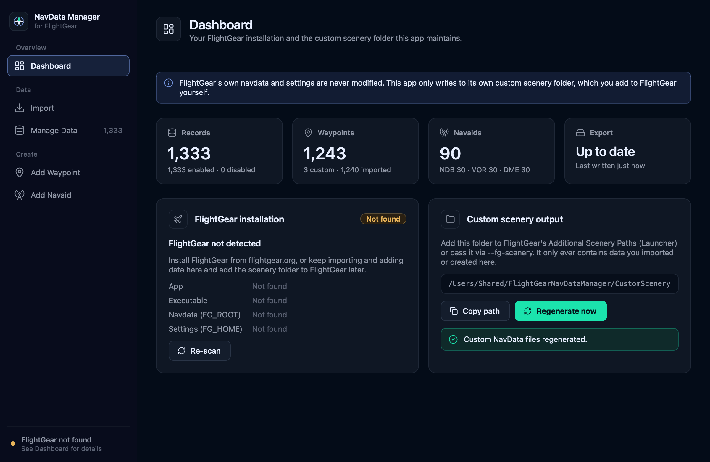
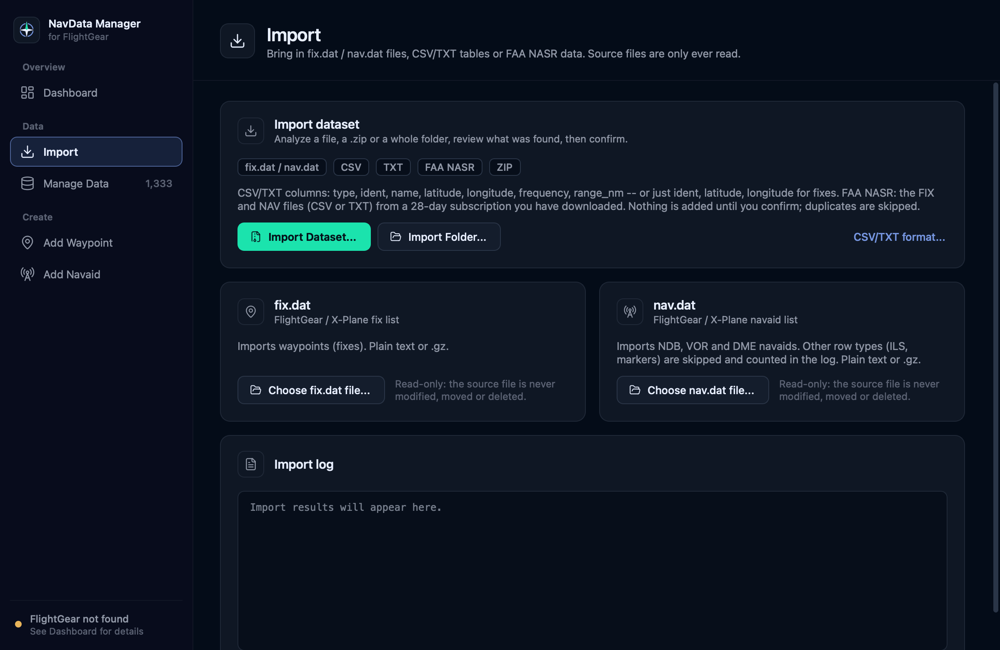
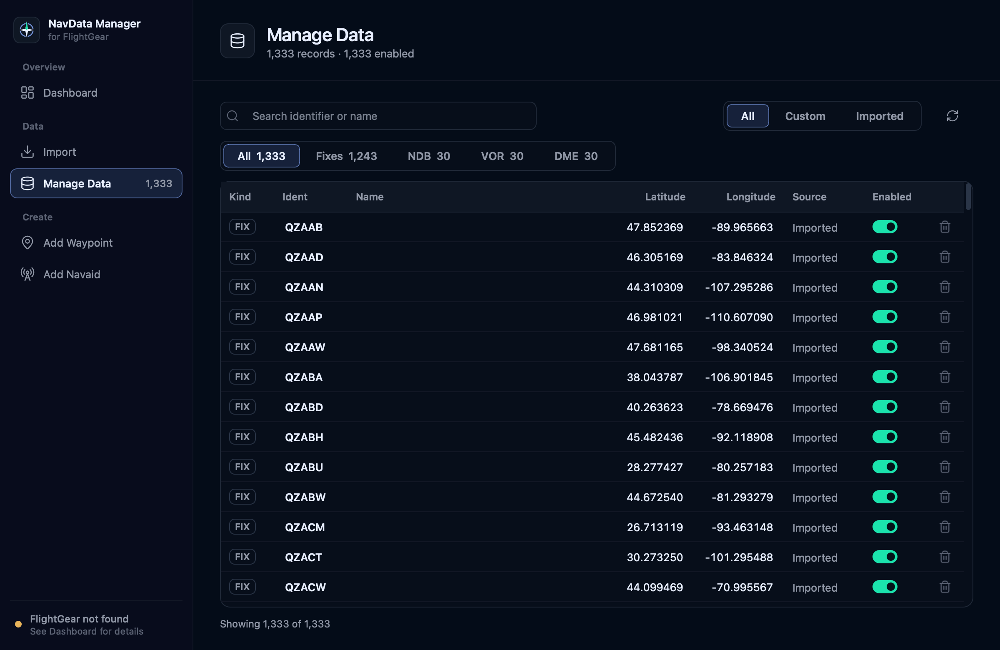
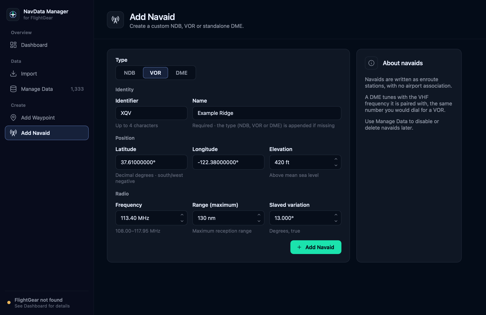

<p align="center"></p>

# FlightGear NavData Manager

A third-party macOS utility for importing, creating, managing and exporting
your own custom [FlightGear](https://www.flightgear.org) navigation data —
fixes/waypoints and basic navaids (NDB, VOR, DME) — as a custom scenery
folder that FlightGear loads alongside its own data.

It **never modifies FlightGear's installed navdata or saved
configuration**. It is not affiliated with or endorsed by the FlightGear
project.



## Features

- Import FlightGear/X-Plane-format `fix.dat` and `nav.dat` files (plain or `.gz`)
- Import your own CSV/TXT tables of fixes and navaids
- Import large FAA NASR datasets that you supply (CSV or legacy TXT, a file,
  a `.zip` or a whole folder) — tens of thousands of records
- Add fixes/waypoints by hand
- Add NDB, VOR and standalone DME navaids by hand
- Search and filter large datasets
- Enable/disable records without deleting them
- Delete records, with confirmation
- Export everything enabled as a custom FlightGear scenery folder
- Dashboard with live statistics, FlightGear detection and export status
- Dark, macOS-oriented interface
- Does not modify FlightGear's installed navdata or saved configuration

## How your data flows

```
Source data you provide          (fix.dat / nav.dat, CSV/TXT, FAA NASR files)
  → the app's own database       (~/Library/Application Support/FlightGearNavDataManager)
  → Manage Data                  (search, enable/disable, delete)
  → custom scenery output        (…/FlightGearNavDataManager/CustomScenery)
  → you add that scenery path to FlightGear
```

- **FlightGear's installed navdata is never modified.** FlightGear's own
  `fix.dat`/`nav.dat` and its saved configuration (scenery paths, settings)
  are never opened for writing — verified against a real FlightGear
  2024.1.6 installation during development.
- **Source files are only read.** Files you import are never modified,
  moved or deleted.
- **No navigation data is included.** The app does not download, bundle or
  redistribute any dataset — including FAA subscription data. You obtain
  source data yourself and are responsible for using it according to the
  terms that apply to it.

## Using the app

### Navigation

The sidebar on the left switches between the five pages: **Dashboard**,
**Import**, **Manage Data**, **Add Waypoint** and **Add Navaid**. The same
pages are in the **Go** menu, with keyboard shortcuts **⌘1–⌘5** in that
order. The sidebar also shows the live record count and whether FlightGear
was detected.

The app uses a dark theme only, regardless of the macOS appearance setting.

### Dashboard

- **Records, Waypoints, Navaids** — live counts from your database
  (enabled/disabled, custom/imported, and NDB/VOR/DME).
- **Export** — whether the custom scenery files are up to date and when they
  were last written.
- **FlightGear installation** — the detected app, version and folders, or a
  calm "Not found" if FlightGear isn't installed (the app works without it).
  **Re-scan** checks again.
- **Custom scenery output** — the folder to add to FlightGear, with
  **Copy path** and **Regenerate now**. If regenerating fails (for example,
  the folder isn't writable), the error is shown on the page and your
  records are unchanged.

### Import



**Import Dataset...** picks a file (or a `.zip`); **Import Folder...** picks
a whole folder. The app works out what each file is from its contents and
**analyzes it first**: you see what will be added, then confirm. Nothing is
stored until you do, and duplicates are skipped. The **fix.dat** and
**nav.dat** cards import those files directly. Every import writes a report
to the **Import log**.

| Recognized | Imports |
|---|---|
| Your own CSV/TXT (format below) | fixes, NDB, VOR, DME |
| FAA `FIX_BASE.csv` (preferred) or legacy `FIX.txt` | waypoints / reporting points |
| FAA `NAV_BASE.csv` (preferred) or legacy `NAV.txt` | NDB, VOR, DME |
| FlightGear/X-Plane `fix.dat` / `nav.dat` (plain or `.gz`) | fixes / NDB, VOR, DME |

#### CSV / TXT format

One record per row. A navaid table (fixes may be mixed in) has a `type`
column:

```
type,ident,name,latitude,longitude,frequency,range_nm
NDB,ABC,Example NDB,37.500,-122.300,375,50
VOR,XYZ,Example VOR,37.600,-122.400,113.2,130
DME,XYZ,Example DME,37.600,-122.400,113.2,130
FIX,EBAYE,,37.621,-122.379,,
```

A list of fixes needs only `ident,latitude,longitude` (a `name` column is
allowed and ignored — fixes have no name in FlightGear):

```
ident,latitude,longitude
EBAYE,37.123,-122.456
```

- `type` is FIX, NDB, VOR or DME. Latitude/longitude are decimal degrees
  (south and west negative).
- Frequency is **kHz for NDB** (whole number, e.g. 375) and **MHz for VOR
  and DME** (e.g. 113.20 — a DME's paired VHF frequency); `range_nm` is
  whole nautical miles.
- Optional columns: `elevation_ft` (whole feet), `slaved_variation_deg`
  (VOR), `bias_nm` (DME). Without an `elevation_ft` column, navaids get
  0 ft — the Add Navaid form's default — and the import says so.
- A navaid table **without** a `type` column could hold NDBs, VORs or DMEs,
  so Import Dataset asks which. The app never guesses the type (or the
  frequency unit) from the numbers. Inside a folder import such a file is
  left out with a note; import it on its own.
- Column names can be in any order and any case. The same rules as Add
  Waypoint / Add Navaid apply (identifier length, frequency bands, the
  " NDB"/" VOR"/" DME" name suffix).
- A value a type doesn't have (e.g. a FIX with a frequency) is ignored with
  a warning. Nothing is rounded or guessed: a malformed row is reported with
  its line number and skipped, and the rest still imports.
- `.csv` files are comma-separated. `.txt` files may be tab-, comma- or
  space-separated; with spaces, quote names that contain spaces
  (`VOR XYZ "Example VOR" 37.6 -122.4 113.2 130`). A `.txt` may leave out
  the header if its columns are in one of the orders above. Blank lines and
  lines starting with `#` are ignored. Text is UTF-8.
- If the layout can't be determined safely, the file is refused with a
  message rather than guessed at.

The **CSV/TXT format...** link on the Import page shows the same help.

#### FAA NASR data

FAA aeronautical / National Airspace System data — such as the FAA's
28-day NASR subscription files — is publicly available from the FAA; you
download it yourself, and the app imports the files you select. The app
does not include or redistribute it.

In a folder, everything else — airports, airways, procedures, remarks,
layout documents — is ignored. The FAA ships its CSV files zipped; the app
looks inside `.zip` files, so there's no need to unpack. If a folder has
both the CSV and TXT version of the same data, only the CSV is used (the
FAA is retiring TXT). CSV columns are found by name, so a future FAA column
reordering doesn't matter; a CSV missing a required column is refused with a
message naming the missing columns. The summary shows the FAA effective
date when the files include one (`FIX.txt` doesn't).

**How FAA navaids are mapped**

| FAA facility type | Becomes |
|---|---|
| NDB, MARINE NDB | NDB |
| VOR | VOR |
| VOR/DME, VORTAC | VOR + DME |
| NDB/DME | NDB + DME |
| DME, TACAN | DME |
| VOT, FAN MARKER, others | unsupported |

- Service range comes from FAA's published standard service volumes (e.g.
  "H" = 130 nm, "L" = 40 nm, "T" = 25 nm) or NDB class (HH 75, H 50, MH 25,
  compass locator 15 nm). If FAA gives neither, the facility is reported as
  invalid rather than guessed. (`NAV.txt` can also fall back to a VOR's
  class altitude code, which the CSV doesn't have, so it places a few more
  VORs than `NAV_BASE.csv`.)
- A DME that FAA sites apart from its VOR/NDB uses its own antenna
  position. For NDB/DME, the DME's paired VHF frequency is derived from its
  TACAN channel using the standard ICAO pairing table.
- Not kept: city/state/country, owner, hours, remarks, holding patterns,
  checkpoints, fix use/charting data, and other FAA details this app has no
  field for.

#### Duplicates

One policy applies to every import and to Add Waypoint / Add Navaid. Only
records of the same kind are compared — a VOR and an NDB sharing an
identifier are unrelated:

- **Duplicate** — same kind and identifier within 1 nm and, for navaids,
  the same frequency. Imports skip it. Records you've disabled count, so
  importing the same data again never re-enables what you switched off.
- **Identifier conflict** — same kind and identifier as one of your enabled
  records within 100 nm (fixes) or 50 nm (navaids), but at a different
  position or frequency. Imports skip it and your existing record is left
  unchanged; the log lists both. To take the new one, disable or delete
  yours and import again.
- Further away, a same-named record is a different place and is imported.

Each import reports how many records were **imported**, **duplicates
skipped**, **identifier conflicts**, **invalid rows**, **unsupported**, and
**warnings**, followed by the details (with line numbers).

### Manage Data



Every imported and custom record in one table, built to stay fast with
tens of thousands of records.

- **Search** matches identifier or name (case-insensitive). **⌘F** jumps to
  the search field; **Esc** clears it.
- **Type filter** (All / Fixes / NDB / VOR / DME, each with its count) and
  **source filter** (All / Custom / Imported) combine with the search. The
  footer shows "Showing X of Y".
- The **Enabled switch** includes or excludes a record from the export
  without deleting it.
- The **trash icon** (or the Delete key on a selected row) deletes a record
  permanently, after confirmation. **No** is the default.

Every change regenerates the custom scenery output.

### Add Waypoint and Add Navaid



- **Add Waypoint** creates a fix from an identifier (up to 10 characters)
  and a latitude/longitude in decimal degrees.
- **Add Navaid** creates an **NDB**, **VOR** or standalone **DME** (choose
  with the NDB | VOR | DME control). Fields cover identity, position and
  radio data: NDB frequency in kHz; VOR frequency in MHz with slaved
  variation; DME paired VHF frequency in MHz (not a channel number) with
  optional bias.

Invalid input is explained right on the form. If the new record duplicates
or conflicts with an existing one, the app shows which record matches;
**Cancel** is the default, and only **Add Anyway** creates it. Existing
records are never overwritten.

## Supported data types

| Type | Notes |
|---|---|
| FIX / waypoint | Latitude, longitude, identifier |
| NDB | Frequency in **kHz** |
| VOR | Frequency in **MHz** |
| DME (standalone) | Paired VHF frequency in **MHz** — the frequency it's tuned with, not a DME channel number |

All navaids are enroute-only (no airport/terminal association) in this
version. ILS, localizer, glideslope, marker beacons and paired
VOR-DME/VORTAC composites are intentionally out of scope, as are instrument
procedures and airport data.

## Using your data in FlightGear

The Dashboard page shows your custom scenery folder's path (under
`~/Library/Application Support/FlightGearNavDataManager/CustomScenery`,
containing `NavData/fix/custom.dat` and `NavData/nav/custom.dat`). To use it
in FlightGear:

- In the FlightGear Launcher, add that folder under **Additional Scenery
  Paths**, or
- Pass it on the command line: `--fg-scenery=<the path shown on the
  Dashboard>`

This app never edits FlightGear's configuration for you — you decide
whether and how to wire it in. FlightGear loads scenery-path data *before*
its own stock defaults, so a custom entry with the same identifier as a
stock one (within FlightGear's own ~10–15 nm proximity match) takes
precedence, without the stock file ever being touched.

## Requirements and the release build

The v0.1.0 release build is:

- a **macOS** application for **Apple Silicon (arm64)** only;
- minimum **macOS 11.0** (as declared in the app bundle);
- **ad-hoc signed, not notarized** by Apple;
- self-contained — no separate Python installation needed.

FlightGear 2024.1.x (tested against 2024.1.6) is needed to actually fly
with the exported data; the app itself runs and manages data without it.

**First launch on another Mac:** because the app is not notarized, macOS
Gatekeeper may block it the first time it's opened. On current macOS
versions you can usually allow it by Control-clicking (right-clicking) the
app and choosing **Open**, or via **System Settings → Privacy & Security**.
The exact steps depend on your macOS version and security settings and may
change in future releases.

## Development

Requires Python 3.11 or newer (the test suite passes on 3.11 with PySide6
6.8, and on 3.14 with PySide6 6.11; the release build was validated on
Python 3.14).

```sh
python3 -m venv .venv
.venv/bin/pip install -e ".[dev,build]"
```

| Task | Command |
|---|---|
| Run from source | `.venv/bin/python -m flightgear_navdata_manager` |
| Run the tests | `.venv/bin/pytest` |
| Regenerate the logo SVGs and `packaging/AppIcon.icns` | `.venv/bin/python tools/build_brand_assets.py` |
| Build the macOS app (into `dist/`) | `.venv/bin/pyinstaller --noconfirm "packaging/FlightGear NavData Manager.spec"` |
| Smoke-test the built app | `tools/smoke_packaged_app.sh` |
| Capture UI screenshots (sandboxed) | `.venv/bin/python tools/capture_ui.py <out-dir>` |

The tests never touch your real app data: `tests/conftest.py` redirects
every data path to a throwaway folder and fails the run if the real files
change.

**Developer/test infrastructure only:** a few `FGNAV_*` environment
variables exist so the test tools can run the app — including the packaged
app — against throwaway data: `FGNAV_DATA_DIR` (database and output
location), `FGNAV_SETTINGS_DIR` (window settings), `FGNAV_ASSUME_NO_FLIGHTGEAR`
(simulate FlightGear not being installed) and `FGNAV_SMOKE_OUT` (run the
built-in smoke test; refuses to run without `FGNAV_DATA_DIR`). They are not
user features.

## License

FlightGear NavData Manager is released under the [MIT License](LICENSE).
Third-party components — Lucide icons (ISC) and Qt/PySide6 (LGPLv3),
among others — keep their own licenses; see
[THIRD_PARTY_NOTICES.md](THIRD_PARTY_NOTICES.md).

## A note on data currency

This tool does not include, generate or validate real-world aeronautical
data, and it is not a substitute for a current, official AIRAC-cycle
navigation database. Anything you import or create here is exactly what you
gave it — accurate, current, real-world navigation data remains your
responsibility to source appropriately. Do not use this tool, or FlightGear
itself, for real-world navigation.
